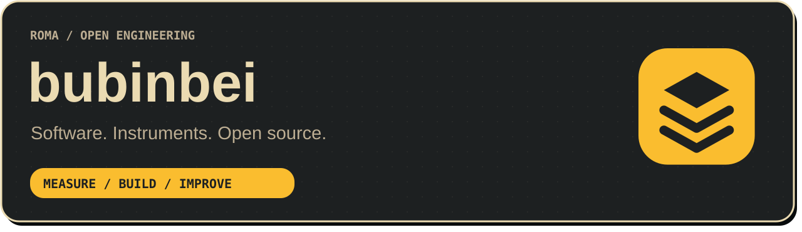
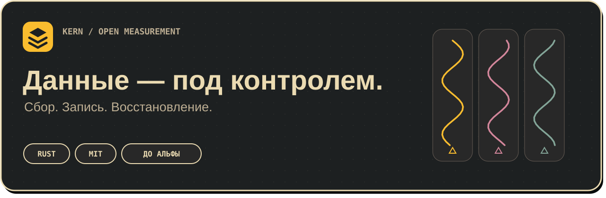

<strong>Русский</strong> · <a href="README.en.md">English</a>

# Рома · bubinbei

Разрабатываю инструменты для измерений и сбора данных. Мне интересны понятные интерфейсы, связь с реальными приборами и программы, которые бережно относятся к ресурсам компьютера.

## Сейчас в работе — KERN

**Rust · регистрация измерений · плагины · Windows 10**

Независимый проект с новой историей: устойчивое ядро Rust, сырой журнал, сменные плагины и восстановление после отказов. Архитектура согласована; реализация нового ядра впереди. Проект находится до альфы.

[Исходный код →](https://github.com/bubinbei/kern) · [План разработки](https://github.com/bubinbei/kern/blob/main/docs/ROADMAP.md) · [Документация](https://github.com/bubinbei/kern/blob/main/docs/ARCHITECTURE.md)

---

**Небольшое ядро. Явное качество данных. Проверяемые результаты.**
